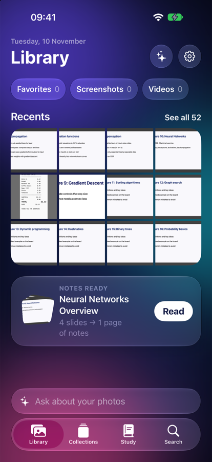
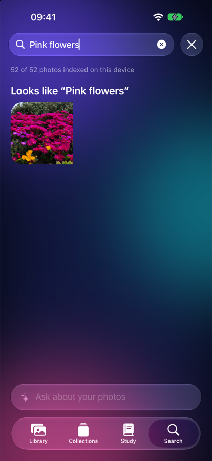
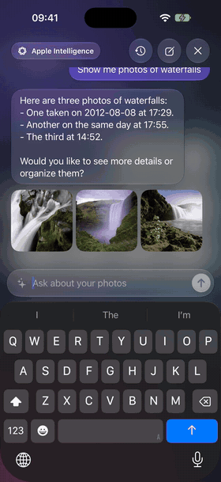
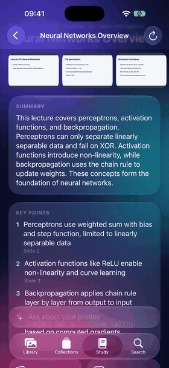

# Project Proposal: Phophy

**An on-device AI assistant for your photo library: search by description, automatic organisation, study notes from lecture slides, and AI photo editing.**

---

## 1. Overview

Phophy is an iPhone app that indexes the photo library on the phone, finds photos from a description, answers questions about them, turns lecture slides into notes and edits photos from a typed request.

---

## 2. Project goal

### The problem

A typical phone holds thousands to tens of thousands of photos, and they are hard to use:

- **Finding a photo is slow.** Built-in search works mostly by date, place and a fixed set of labels. A question such as "the whiteboard with the network diagram", "the receipt from Muji" or "the slide about the TCP handshake" usually ends in minutes of scrolling.
- **The library is unorganised.** Screenshots, documents, receipts, slides and near-identical burst shots are mixed in with personal photos, and cleaning them up by hand is tedious.
- **Students photograph lecture slides but rarely use them again.** The slides sit in the camera roll as images, with no text, no grouping by lecture and no notes.
- **Sending everything to a cloud AI is the wrong answer.** It is slow, it costs money for every photo, and it uploads private pictures.

### Objectives

Build an iOS app, **Phophy**, that:

1. **Indexes the whole photo library on the phone.** For each photo it records the text in the image, scene labels and a semantic embedding, with no photo leaving the device.
2. **Finds photos from a natural-language description.** Search combines text in the photo, labels, date, place and visual similarity, in English and Chinese.
3. **Organises the library automatically.** It sorts photos into categories (slides, documents, receipts, food, people, pets, scenery, screenshots) and finds near-duplicate shots, suggesting which one to keep.
4. **Answers questions through an AI assistant.** The assistant uses tools over the local index, for example "find my photos from the Kyoto trip with the red gate and put them in an album". It runs on Apple Intelligence where available, or on a cloud model the user chooses (Claude, OpenAI or any OpenAI-compatible service).
5. **Turns lecture-slide photos into study material.** Slides are grouped by lecture and become a summary, key points and flashcards. Only the recognised text is sent to the model, never the images.
6. **Edits photos from a typed request.** Requests such as "brighter and blur the background" run on the phone for free; generative edits go to an image API only when the user asks.
7. **Stays fast and respects the phone.** Browsing must feel like Apple's Photos app on a large library, and indexing must not drain the battery or overheat the phone. The app must also work on phones without Apple Intelligence, such as the iPhone 13 Pro Max.

**Optional stretch goal: an Android version.** If time allows after the iOS objectives are met, build an Android app with the same core features (on-device indexing, search by description, categories and lecture notes), so the project is not limited to iPhone users. This is lower priority than objectives 1–7 and will not delay them.

---

## 3. Potential solutions

### 3.1 Key idea: tiered processing, with the cloud last

Most of the work does not need a paid language model. Each photo is processed once, on the phone, and the results are stored in a local database. Search then runs against the database, not against a model that charges per photo.

---

## 4. Experimental plan

All experiments run on the team's own iPhones (including an iPhone 13 Pro Max without Apple Intelligence) and on the iOS simulator. Each one is repeatable from a fixed dataset or a built-in debug test.

### 4.1 Datasets

- **Search evaluation set.**
  - About 50 real questions written by the authors about their own libraries, each with its correct photo or photos marked.
  - The questions mix five types: place and time ("Hong Kong two years ago"), content ("the whiteboard with the network diagram"), text in the photo ("the receipt from Muji"), vague ("that sunset at the beach"), and language (English and Chinese).
- **Category labels.** About 300 photos labelled by hand into the app's categories, including "none".
- **Near-duplicate pairs.** About 100 photo pairs labelled as same shot or different.
- **Lecture slides.** Photos of at least 5 real lectures, with slide text checked by hand.
- **Edit requests.** About 30 typed requests in English and Chinese, each with its expected edits.
- **Scale test.** A generated library of 50,000 photos in the simulator.

### 4.2 Experiments and metrics

| # | Question | Method | Metrics |
|---|---|---|---|
| E1 | Does hybrid search beat simpler search? | Compare keyword only, CLIP only, and hybrid (reciprocal rank fusion), plus the iPhone's built-in Photos search as a manual baseline | Recall@5, recall@20, mean reciprocal rank |
| E2 | Which embedding model is worth its cost? | MobileCLIP S0 against S2 on the same evaluation set | Recall@5, index time per photo, model size, memory |
| E3 | How to handle Chinese queries, when MobileCLIP only understands English? | (a) no handling, (b) the assistant rewrites the query in English, (c) on-device translation before encoding | Recall@5 on the Chinese questions |
| E4 | Do OCR text embeddings help text-heavy questions? | Add a multilingual sentence embedding of the OCR text and compare | Recall@5 on text questions ("notes about TCP handshakes") |
| E5 | How good are automatic categories? | Run on the labelled set and tune the thresholds on a separate part of it | Precision, recall and F1 per category |
| E6 | Where should the duplicate threshold be? | Sweep the cosine similarity threshold from 0.85 to 0.97 | Precision–recall curve; choose the threshold with high precision, since deleting is costly |
| E7 | Can the assistant complete tasks? | 20 end-to-end tasks run on each backend (Apple Intelligence, Claude Haiku, an OpenAI model) | Task success rate, number of tool calls, response time, cost per task |
| E8 | Are the lecture notes useful and faithful? | Notes are rated by people who attended the lectures; key points are checked against the slide text | 1–5 ratings for usefulness and accuracy; unsupported statements per summary; flashcard correctness |
| E9 | Are edit requests understood? | Run the request set through word rules alone, and word rules plus the on-device model | Exact-match rate, response time |
| E10 | Does the app stay fast on a large library? | Built-in debug test (`-PhophyOpenTest`) and Instruments traces on the iPhone 13 Pro Max | Worst frame time when opening a photo, dropped frames while scrolling during indexing, photos indexed per minute, memory, battery drain and thermal state per 1,000 photos |
| E11 | How much does the cloud cost? | Log tokens per request | Cost per assistant answer and per lecture summary |

### 4.3 Success criteria

- **Search:** hybrid search reaches clearly higher recall@5 than keyword-only search and the built-in Photos search on the evaluation set.
- **Speed:** scrolling and swiping hold full frame rate on the iPhone 13 Pro Max while an index of more than 5,000 photos is running, and opening a photo never freezes the screen.
- **Phones without Apple Intelligence:** every feature works through the word rules or a cloud backend.
- **Lecture notes:** they average at least 4/5 for accuracy, with no unsupported key points.
- **Cost:** cloud cost stays under one cent per assistant answer or lecture summary.

### 4.4 Current status and early measurements

The app already has working first versions of browsing, indexing and search, categories and duplicates, the assistant, lecture notes, and the editor. Figure 2 shows screens from the current build, running in the iOS simulator.

*Figure 2. Screens from the current app. Library: recent photos, categories and the newest lecture. Search: "pink flowers" found by how the photo looks, with no text in it. Collections: photos sorted into categories on the phone. Assistant: "show me photos of waterfalls", answered by Apple Intelligence. Study: notes made from a lecture's slide photos. Viewer: a full-screen receipt, whose text the index has read.*

Early measurements:

- **Speed:**
  - Opening a photo in a library of about 16,000 photos used to freeze the screen for 1.5–3 seconds. After switching the viewer to a collection view that reuses its pages, the worst frame is 17–80 ms.
  - Indexing now pauses while the user scrolls or views a photo, to remove the remaining stutters. This still needs to be measured in E10.
- **Edit requests:** in a first test, 12 sample requests were all read correctly by the on-device model, in about 1–3.5 seconds each. E9 will repeat this on the full request set.
- **Tuning:** the search and category thresholds were set by hand on a few test photos. Experiments E1, E5 and E6 will replace them with values tuned on the datasets above.

### 4.5 Work arrangement

| Role | Area | Responsible for | Experiments |
|---|---|---|---|
| Lead | Design and integration | Overall design and integration, the Study tab (lecture notes), reviewing and merging code, the report and the demo | E8 |
| Track A | Performance and indexing | Indexing speed, memory and battery, background indexing, the embedding models, reliability | E2, E10 |
| Track B | Search and assistant | Search quality, the search evaluation set, Chinese queries, the assistant's tools and backends, cloud cost | E1, E3, E4, E7, E11 |
| Track C | Viewer, editing and collections | The photo viewer and grids, the editor, categories and similar photos | E5, E6, E9 |

Everyone writes search questions about their own libraries and test the app on their own phones.

### 4.6 Timeline

The project is submitted on **30 November 2026**, about two weeks after this proposal. This is enough because the core app already works (section 4.4), so the time goes mainly into experiments, tuning and the report. The four members work in parallel on their own tracks.

| Dates | Lead | Track A | Track B | Track C |
|---|---|---|---|---|
| 16–19 Nov | Collect lecture photos; set up the shared dataset format; review the first changes | Measure the current app (E10 baseline); start background indexing while charging | Write the search questions; build the in-app evaluation runner; E1 baseline | Label category photos and duplicate pairs; write the edit requests |
| 20–23 Nov | Improve lecture grouping and the notes prompts | Compare MobileCLIP S0 and S2 (E2); memory and model loading | Chinese queries (E3) and OCR text embeddings (E4); tune search | Tune categories (E5) and the duplicate threshold (E6) |
| 24–27 Nov | Rate lecture notes (E8); integrate all tracks; draft the report | Scale test with 50,000 photos; battery and heat (E10) | Assistant tasks on each backend (E7); cost logging (E11) | Edit requests (E9); polish the viewer and editor |
| 28–30 Nov | Final report, demo and submission | Final speed numbers; fix speed problems | Final search numbers; fix search problems | Screenshots and demo video; fix interface problems |

Optional: the Android version of indexing and search is started only if the iOS work is ahead of schedule; otherwise it is listed as future work.

---

## 5. Code repository

The code is on GitHub at **https://github.com/Jasonsu22/Phophy** (public). It is a native iOS app written in Swift and SwiftUI, for iOS 26 and later, and builds with Xcode.

| Folder | What it contains |
|---|---|
| `Phophy/Index/` | The background indexer, the SQLite index, the search engine, place names, and the code that pauses indexing while the screen is busy |
| `Phophy/CLIP/` | MobileCLIP image and text encoders and the tokenizer (the model files are downloaded separately, not stored in git) |
| `Phophy/Collections/` | Categories and similar-photo detection |
| `Phophy/Assistant/` | The assistant, its tools, and the Apple Intelligence and cloud backends |
| `Phophy/Study/` | Lecture grouping and the lecture notes |
| `Phophy/Viewer/` | The full-screen photo and video viewer |
| `Phophy/Editor/` | The photo editor and the AI image service |
| `Phophy/Settings/` | Settings, including API keys kept in the Keychain |
| `Phophy/Debug/` | Debug-only measuring tools, such as the frame-time monitor |
| `PLAN.md`, `TEAM_PLAN.md`, `README.md` | The design, the team plan with known bugs, and how to build and run the app |

How the team works in the repository:

- One branch per task, merged into `main` through a pull request reviewed by another member.
- Every change is built in the simulator and checked on a real phone, including the iPhone 13 Pro Max, before it is merged.
- Rules every change must keep: no API keys or personal photos in the repository; keys stay in the Keychain; photos never leave the phone unless the user turns on a feature that says so.
- Results of each experiment are recorded in the repository, so they can be repeated.

---

## 6. Risks

| Risk | Mitigation |
|---|---|
| MobileCLIP understands only English | Experiment E3 (query rewriting and on-device translation) |
| Apple's on-device model is small and sometimes invents filters | Loosen filters when results are empty; prefer cloud backends for complex tasks; measure in E7 |
| The search evaluation set is small and personal | Mix question types and include several people's libraries; report results per question type |
| Battery and heat from indexing | Indexing pauses when the phone is hot or in Low Power Mode, with overnight indexing while charging; measured in E10 |
| Privacy | All indexing on device; the cloud receives only text, and only for the request the user makes |
| Licences | MobileCLIP weights use Apple's research licence; check before any public release |
| Building for Android splits the team's time | Android is a stretch goal, started only once the iOS objectives are met |
| Two weeks is a short time | The app is already built; the datasets are kept small, the tracks work in parallel, and E2–E4 are dropped first if time runs short |
