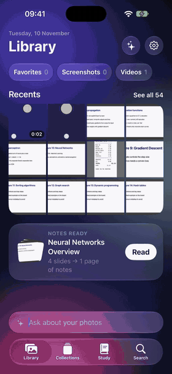
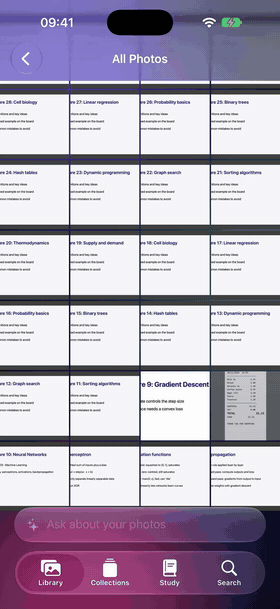
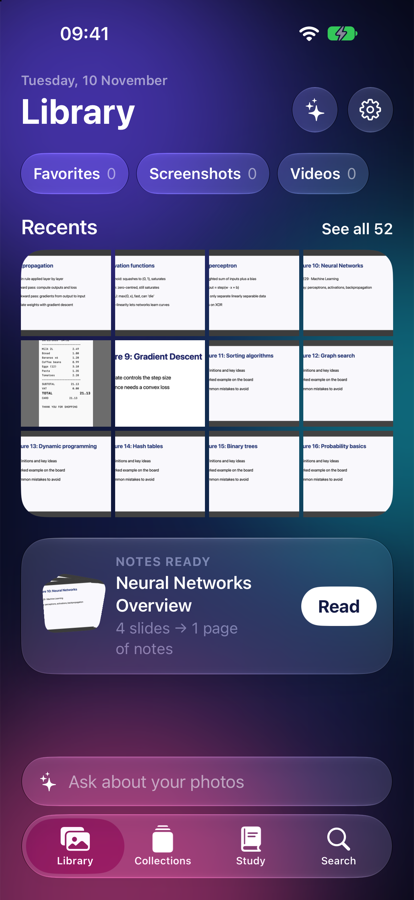
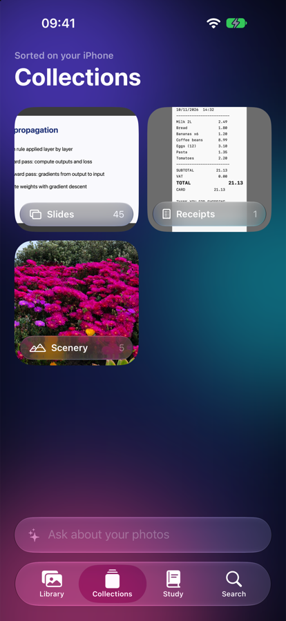
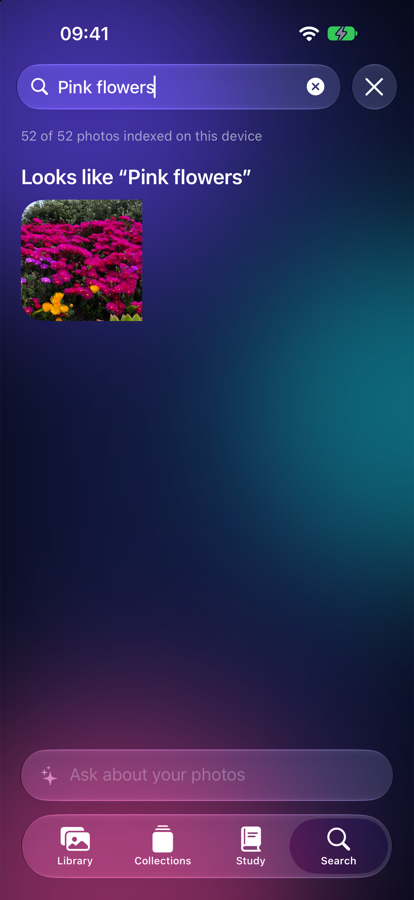

<p align="center">
  
</p>

<p align="center">
  <b>An AI photo app for iPhone.</b> Find any photo by describing it, let it sort your library,<br>
  and turn the lecture slides you photographed into notes and flashcards.
</p>

<p align="center">
  
  
  
  
</p>

---

## See it move

<table>
  <tr>
    <td align="center" width="33%"></td>
    <td align="center" width="33%"></td>
    <td align="center" width="33%"></td>
  </tr>
  <tr>
    <td align="center"><b>Ask</b><br><sub>Type a question; matching photos come back with the answer.</sub></td>
    <td align="center"><b>View</b><br><sub>Photos open and close like Apple's Photos app.</sub></td>
    <td align="center"><b>Study</b><br><sub>Slide photos become a summary, key points and flashcards.</sub></td>
  </tr>
</table>

<table>
  <tr>
    <td align="center" width="33%"></td>
    <td align="center" width="33%"></td>
    <td align="center" width="33%"></td>
  </tr>
  <tr>
    <td align="center"><b>Library</b></td>
    <td align="center"><b>Collections</b></td>
    <td align="center"><b>Search</b></td>
  </tr>
</table>

## What it does

| | |
|---|---|
| 🔎 **Search by description** | "pink flowers", "whiteboard", or any word written in a photo. |
| 🗂 **Sorts itself** | Slides, documents, receipts, food, people, pets and scenery. Near-duplicates are grouped for clean-up, and any collection can be saved as an album. |
| ✨ **Assistant** | Ask about your library in plain words. It finds photos, counts them, and offers to make albums. Past chats are kept on your phone. |
| 📚 **Lecture notes** | Slides photographed in one lecture become one page: summary, key points with slide numbers, and flip-card flashcards. |
| 🖼 **Viewer** | Zooms out of its thumbnail, pinch or double-tap to zoom, swipe between photos, swipe down to close. |

## Private and cheap by design

Phophy reads each photo **once, on the iPhone**. Text recognition and labels come from Apple's Vision framework, and description search from Apple's MobileCLIP model. Indexing thousands of photos costs nothing and uploads nothing.

A language model is only used for the assistant and lecture notes, and it only ever receives **text**: dates, labels and the words read from photos, never the images. You choose which model in Settings:

| Model | When |
|---|---|
| Apple Intelligence | Used first on iPhones that have it. Free and offline. |
| Claude, OpenAI, or any OpenAI-compatible service | For other iPhones, or by choice. Bring your own API key; it stays in the Keychain. |

## Run it

Requires Xcode 27 or later and an iPhone or simulator on iOS 26 or later.

1. Clone the repo and open `Phophy.xcodeproj`.
2. Download Apple's MobileCLIP models into `Phophy/CLIP/Models/` (see [PLAN.md](PLAN.md#mobileclip-models-not-in-git)). Without them, the app still runs with text and label search only.
3. Choose a simulator or your iPhone and press **Run** (⌘R). On a real iPhone, select your Apple ID team under *Signing & Capabilities* first; a free account works.

To try it in the simulator with your own pictures:

```bash
xcrun simctl addmedia booted ~/Pictures/test/*.jpg
```

## How it's built

| Path | What's inside |
|---|---|
| `Phophy/RootView.swift`, `LibraryView.swift` | Tabs, ask bar, home screen |
| `Phophy/PhotoLibrary.swift`, `PhotoGridView.swift` | PhotoKit access, filters, grids |
| `Phophy/Viewer/` | Full-screen photo viewer |
| `Phophy/Index/` | On-device index (SQLite via GRDB), indexer, search engine |
| `Phophy/CLIP/` | MobileCLIP encoder and tokenizer |
| `Phophy/Collections/` | Categories, similar-photo clean-up |
| `Phophy/Assistant/` | Chat, chat history, photo tools, Apple Intelligence and cloud backends |
| `Phophy/Study/` | Lecture grouping, notes, flashcards |
| `Phophy/Settings/` | Settings, AI provider choice, Keychain storage |

The full plan, cost reasoning and build phases are in [PLAN.md](PLAN.md).

## Roadmap

- [x] Library, search, collections, assistant, lecture notes
- [ ] AI photo editing
- [ ] Indexing in the background while charging
