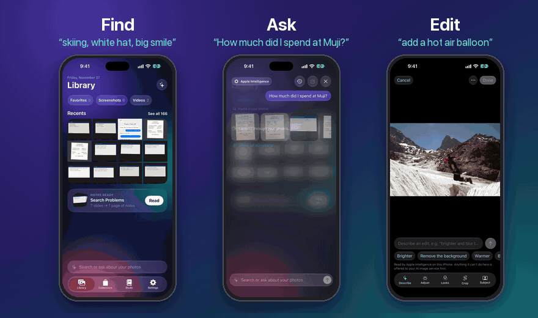
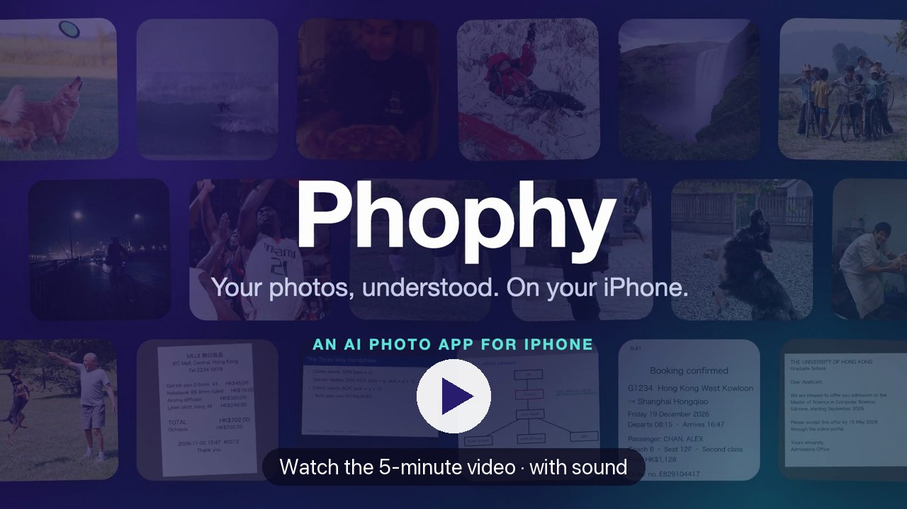

<p align="center">
  
</p>

<h1 align="center">Phophy</h1>

<p align="center">
  <b>Your photos, understood. On your iPhone.</b><br>
  Find any photo by describing it, ask about what's inside, turn lecture slides into notes, and edit by typing the change.
</p>

<p align="center">
  
</p>

<p align="center">
  <a href="https://github.com/Jasonsu22/Phophy/raw/main/docs/media/phophy-video.mp4"></a>
</p>

<p align="center">
  
  
  
  
</p>

## 💡 Why Phophy

A phone holds thousands of photos, and the one you want is always buried. You remember a ski trip, a white hat, a big smile, but not the month, so you scroll and give up. Lecture slides you photograph end up in the camera roll and are never opened again. Built-in search knows dates, places and a fixed set of labels, not descriptions, and sending every photo to a cloud AI is slow, costly and gives your private photos away. Phophy reads every photo once, on the phone, so you can find, ask, study and edit in plain language.

## ✨ What it does

<table>
  <tr>
    <td width="50%" valign="top" align="center">
      
      <h3>🔎 Find by describing</h3>
      <p align="left">Type the few things you remember, like <i>“skiing, white hat, big smile”</i>, a word written in the photo, or a place and month. Only photos that really match come back.</p>
    </td>
    <td width="50%" valign="top" align="center">
      
      <h3>💬 Ask about your photos</h3>
      <p align="left"><i>“How much did I spend at Muji?”</i> The assistant searches your library with tools and reads the answer from the receipt.</p>
    </td>
  </tr>
  <tr>
    <td width="50%" valign="top" align="center">
      
      <h3>📚 Slides become notes</h3>
      <p align="left">Slides photographed in one lecture become one page: a summary, key points with slide numbers, and flip-card flashcards.</p>
    </td>
    <td width="50%" valign="top" align="center">
      
      <h3>🎨 Edit by describing</h3>
      <p align="left"><i>“Warmer and more vivid”</i> runs on the iPhone for free. Bigger requests, like adding a hot air balloon, go to an image service you choose, after you confirm.</p>
    </td>
  </tr>
  <tr>
    <td width="50%" valign="top" align="center">
      
      <h3>🌏 English and 中文</h3>
      <p align="left">Ask in Chinese and Phophy still finds English photos: searches are translated on the phone, and simplified and traditional characters match each other.</p>
    </td>
    <td width="50%" valign="top" align="center">
      
      <h3>🗂 Sorts itself</h3>
      <p align="left">Slides, documents, receipts, food, people, pets and scenery, sorted automatically. Near-duplicate shots are grouped, with one suggested to keep.</p>
    </td>
  </tr>
</table>

## 🎬 Watch the video

<p align="center">
  <a href="https://github.com/Jasonsu22/Phophy/raw/main/docs/media/phophy-video.mp4"></a>
</p>

<p align="center"><sub>Five minutes: the problem, how it works, the app in action, and what we measured. Recorded on the iPhone 18 Pro Max simulator with a made-up photo library.</sub></p>

## 🧠 How it works

Every photo is read **once, on the iPhone**, by the cheapest tool that works, and the result is stored in a local database:

| Tier | What it gives | Runs on |
|---|---|---|
| 0. Metadata | Date, place, kind of photo | PhotoKit |
| 1. Text and labels | Every word in the photo, scene labels | Apple Vision |
| 2. Embedding | One vector per photo, plus tags from 4,585 English and Chinese concepts | MobileCLIP S0, Core ML |
| 3. Description | One line about what the photo shows | Apple Intelligence, or SmolVLM2 on phones without it |
| 4. Cloud model (optional) | The assistant and notes, text only | Claude, OpenAI or any OpenAI-compatible service |

**Search** runs two rankings and fuses them with reciprocal rank fusion: BM25 keyword matching over descriptions, tags and text, and MobileCLIP similarity between your words and every photo. Before ranking, places and dates become filters, typos are corrected against the index's own vocabulary, and Chinese is translated on the phone.

**The assistant** is a language model that calls five tools over the index (`find_photos`, `list_places`, `list_collections`, `show_photos`, `propose_album`). It only ever sees text, never images, and anything that changes the library waits for your tap.

## 📊 Results

Measured in the iOS simulator; the scripts and raw numbers are in [`Eval/`](Eval/README.md).

| What | Before | Now |
|---|---|---|
| Chinese searches, top 10 correct (Flickr30k, 1,000 photos) | 2% | 51% |
| Misspelled searches, top 10 correct | 13% | 59% |
| Objects found in the top 50 | 51% | 89% |
| Chinese sentences, right photo in the top 5 ([E3](Eval/E3_CHINESE.md)) | 60% (dictionary) | 87% (on-device translation) |
| Paraphrased searches for slides and documents, top 10 ([E4](Eval/E4_OCR_EMBEDDINGS.md), experiment) | 50% | 74% |
| Assistant, 20 real tasks on Apple Intelligence ([E7](Eval/AGENT_EVAL.md)) | | 14–17 of 20, about 7 s each |

A search takes about 10–30 ms.

## 🔒 Private and cheap by design

Indexing and search never leave the phone and cost nothing. A language model is only used for the assistant, lecture notes and reading edit requests, and it receives **text** only: dates, labels and the words read from photos. You choose which model in Settings:

| Model | When |
|---|---|
| Apple Intelligence | Used first on iPhones that have it. Free and offline. |
| Claude, OpenAI, or any OpenAI-compatible service | For other iPhones, or by choice. Bring your own API key; it stays in the Keychain. |

Photos leave the phone in one case only: a generative edit you have confirmed, sent to the image service you chose.

## 🚀 Run it

Requires Xcode 27 or later and an iPhone or simulator on iOS 26 or later.

1. Clone the repo and open `Phophy.xcodeproj`.
2. Download Apple's MobileCLIP models into `Phophy/CLIP/Models/` (see [PLAN.md](PLAN.md#mobileclip-models-not-in-git)). Without them, the app still runs with text and label search only.
3. Choose a simulator or your iPhone and press **Run** (⌘R). On a real iPhone, select your Apple ID team under *Signing & Capabilities* first; a free account works.

To try it in the simulator with a made-up library (photos, slides, receipts and screenshots with known contents):

```bash
python3 Demo/build_library.py CAPTIONS.tsv IMAGES_DIR OUT_DIR
xcrun simctl addmedia booted OUT_DIR/*
```

## 🛠️ How it's built

A native iOS app in Swift 6 and SwiftUI, about 14,000 lines.

| Path | What's inside |
|---|---|
| `Phophy/RootView.swift`, `LibraryView.swift` | Tabs, ask bar, home screen |
| `Phophy/PhotoLibrary.swift`, `PhotoGridView.swift` | PhotoKit access, filters, grids |
| `Phophy/Viewer/` | Full-screen photo viewer |
| `Phophy/Index/` | On-device index (SQLite via GRDB), indexer, search engine, query filters and translation |
| `Phophy/CLIP/` | MobileCLIP encoder and tokenizer |
| `Phophy/Describe/` | Photo descriptions: Apple Intelligence, SmolVLM2 (MLX) or a cloud model |
| `Phophy/Collections/` | Categories, similar-photo clean-up |
| `Phophy/Assistant/` | Chat, chat history, photo tools, Apple Intelligence and cloud backends, cost per answer |
| `Phophy/Study/` | Lecture grouping, notes, flashcards |
| `Phophy/Editor/` | Photo editor, edit requests, AI image service |
| `Phophy/Settings/` | Settings, AI provider choice, Keychain storage |
| `Phophy/Debug/` | Debug-only evaluation runners |
| `Eval/` | Search benchmark, Chinese queries (E3), text vectors (E4), assistant tasks (E7) |
| `Demo/` | The made-up demo library and the presentation video (Remotion) |

The design, cost reasoning and build phases are in [PLAN.md](PLAN.md); the proposal is in [PROPOSAL.md](PROPOSAL.md).

## 🗺️ Roadmap

- [x] Library, search, collections, assistant, lecture notes
- [x] Photo descriptions on the device, Chinese search, AI photo editing
- [ ] Sentence vectors of the text in photos, inside the app (E4)
- [ ] Indexing in the background while charging
- [ ] Assistant and cost measured on cloud models (E7, E11)
